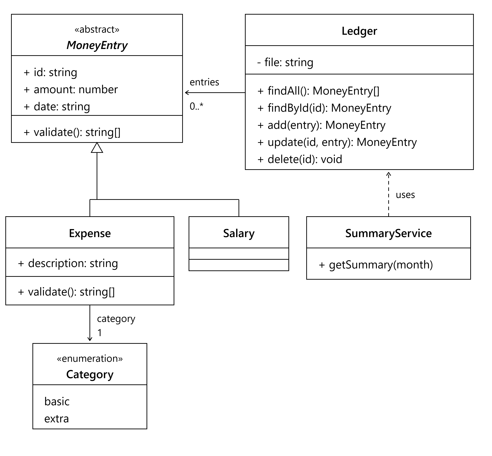

# Expense Tracker — Software Design Document

## UML Class diagram

## Design choices

1. MoneyEntry is an abstract class. Expenses and salaries share id, amount and date, so these are defined once in MoneyEntry instead of twice. It is abstract because the app never creates a plain money entry: every entry is either an Expense or a Salary. Because both are a MoneyEntry, code that works with MoneyEntry (such as the Ledger) works with either one.
2. Category is an enumeration. An expense can only be basic or extra. An enumeration fixes that list in one place, so a typo such as "basci" is rejected instead of being saved, and adding a category later means changing only the enumeration.
