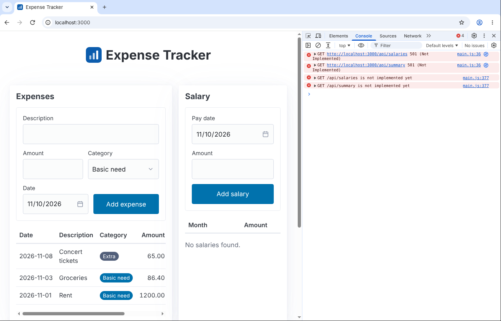
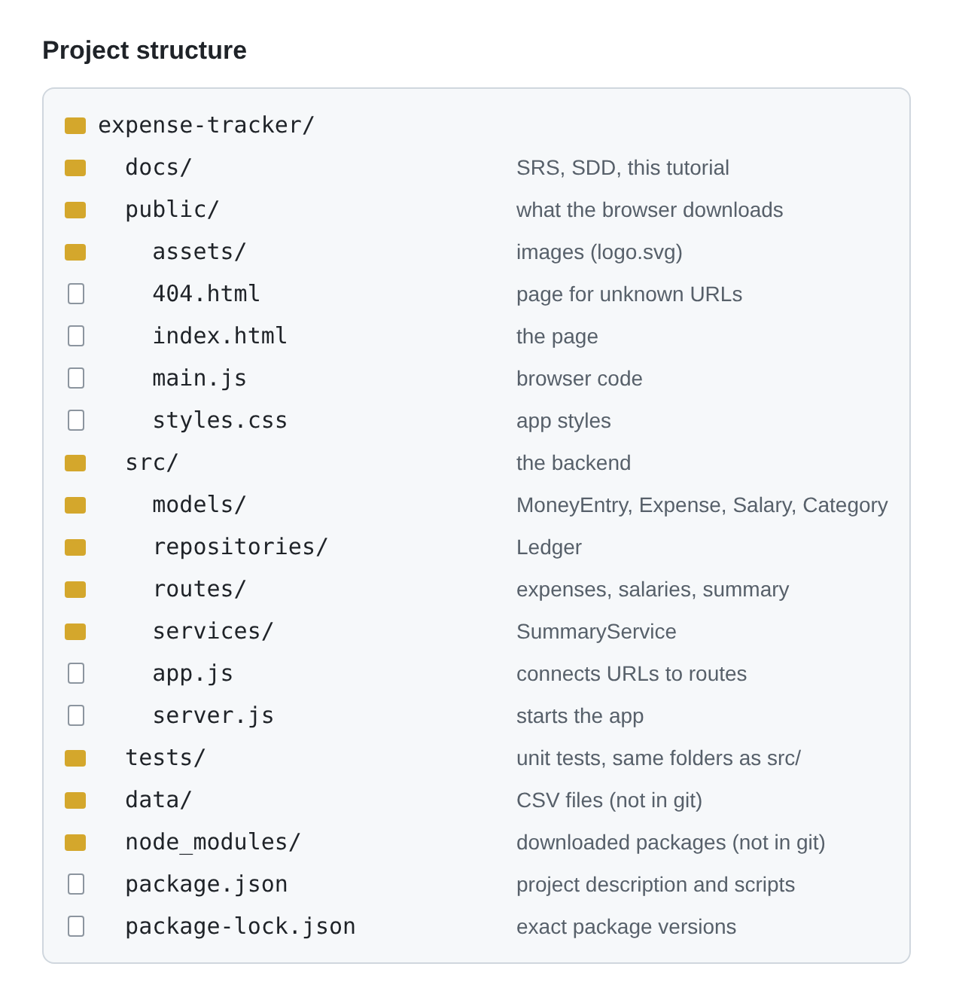
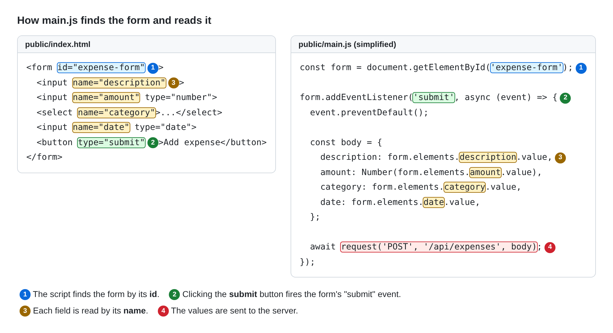
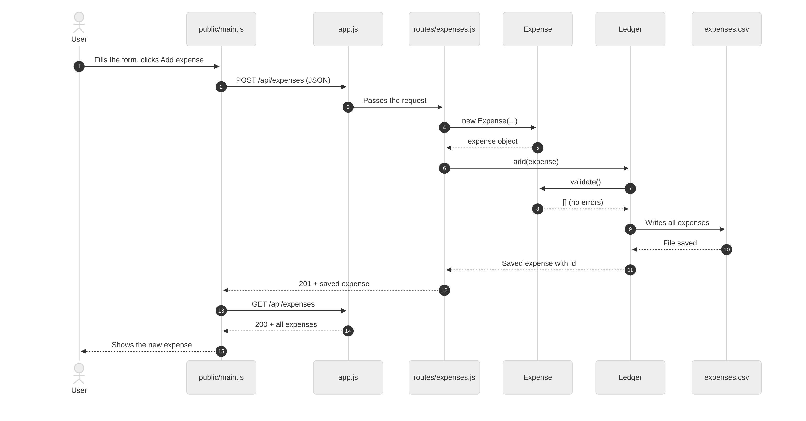
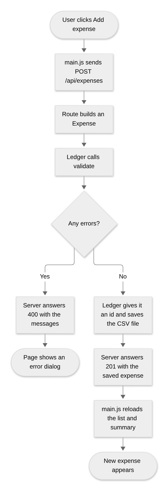
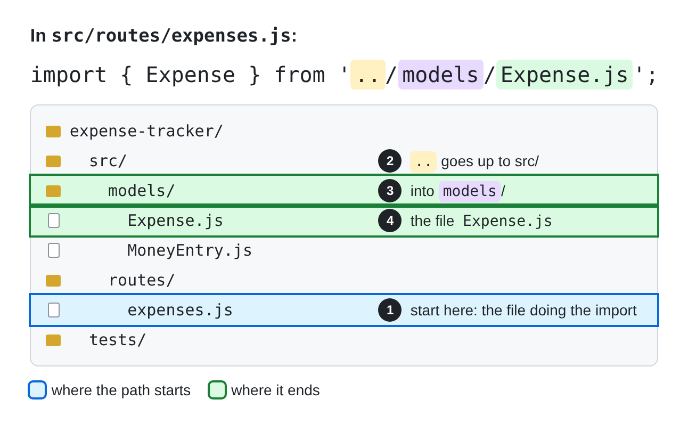
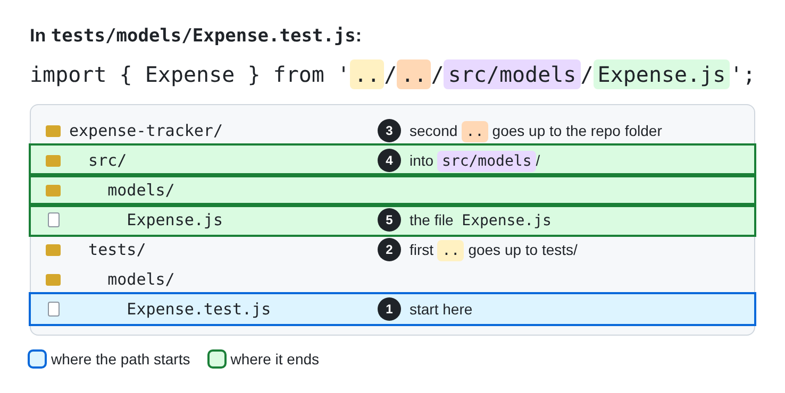
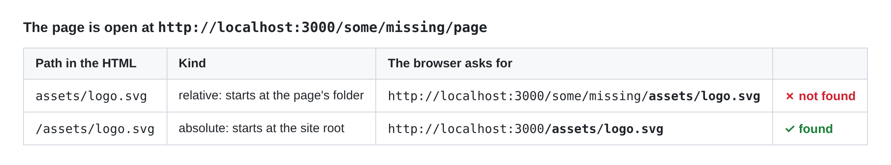
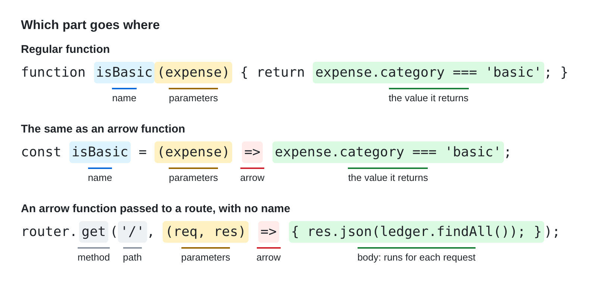
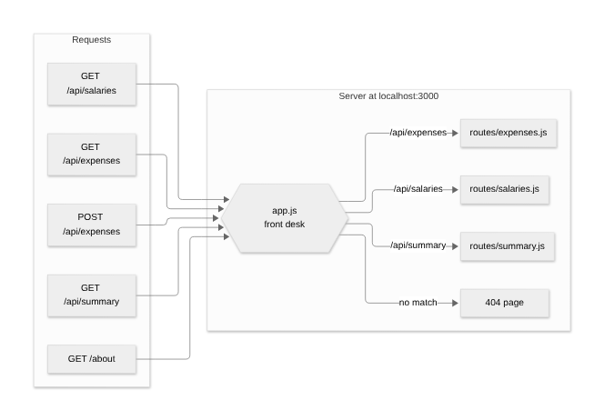

# Expense Tracker: Tutorial

You are finishing the backend of a small web app that tracks expenses and salary. The frontend and the expense API already work. You build the salary API and the summary, and test them.

Read `SRS.md` and `SDD.md` in this folder first. Your tasks and grading are in the separate assignment instructions. This tutorial explains how the code works.

## Viewing markdown files

Markdown file are easier to read as a formatted page. In VS Code:

- **Preview:** press `Ctrl+Shift+V` (`Cmd+Shift+V` on macOS).
- **Edit and preview side by side:** press `Ctrl+K`, release, then press `V`. The preview updates as you type, which helps when filling in the table.

Fill in the table in the editor, not the preview: the preview is read-only.

## 1. Reading this file in VS Code

Markdown files like this one look much better rendered. In VS Code:

- **Preview:** `Ctrl+Shift+V` (`Cmd+Shift+V` on macOS) opens the rendered page.
- **Side by side:** press `Ctrl+K`, release, then press `V`. The preview opens next to the file and updates as you type.
- You can also click the preview icon (a page with a magnifying glass) at the top right of the editor.

The pictures in this tutorial only appear in the preview.

## 2. Setup

### Install Node.js

Check your version:

```bash
node -v
```

You need **v24 or newer** (v26 recommended). If the command fails or shows an older version, install the **LTS** version from [nodejs.org](https://nodejs.org), then open a **new** terminal and check again.

### Install the VS Code extensions

Open the Extensions view (`Ctrl+Shift+X`), search for each of these and click **Install**:

- **Vitest**: run and debug tests from the Testing panel
- **ESLint**: shows code problems as you type

### Run the app

From the repo folder (the one with `package.json`):

```bash
npm install    # downloads the packages into node_modules/
npm run dev    # starts the server
```

- **To run the app:** `npm run dev`
- **To stop it:** press `Ctrl+C` in the terminal

While it runs, the server restarts by itself whenever you save a file in `src/`.

> **Caution**
> The app will not run until you run `npm install`. 


### Try the app

Open **http://localhost:3000** and try it:

- **Expenses** work: add, edit and delete a few.
- **Salary** and **Summary** do not work yet. You have to write them.

You can view messages from the app in the browser console. Either press `F12`, or right-click anywhere on the page and choose **Inspect**. Then open the **Console** tab.

The console is where JavaScript prints messages, much like the console in Java shows what `System.out.println` prints. Here it shows that the salary and summary requests are not implemented yet.



The red lines show that `/api/salaries` and `/api/summary` answered **501 Not Implemented** (remember the lecture on APIs). To print your own messages, use `console.log("hello")`; `console.error(...)` prints in red.

Messages from the **frontend** code (`public/main.js`) appear in the browser console. Messages from the **server** (the `src/` files) appear in the terminal running `npm run dev`.

## 3. What each part does



- **`package.json`** describes the project: its name, the packages it needs (`dependencies` for the app, `devDependencies` for tools like Vitest), and the `scripts` you run with `npm run`. When you run `npm install`, npm downloads every package listed in `package.json`.
- **`package-lock.json`** records the **exact** version of every package that was installed, including the packages those packages need, so everyone gets identical versions. **npm writes it for you: never edit it.**
- **`node_modules/`** is where npm puts the downloaded packages. It is large and can always be recreated with `npm install`, so do not upload it to git: list it in `.gitignore`.
- **`server.js`** starts the app on port 3000. ([What is a port?](https://simone-carolini.medium.com/understanding-networks-an-engineers-guide-to-ips-ports-and-localhost-33d84012456b))
- **`app.js`** builds the app: it decides which code answers each URL, such as sending `/api/expenses` to the expense routes, and serves the files in `public/`. It does not start the server; `server.js` does that. Keeping them apart makes the code easier to organize and test. ([Read more](https://www.geeksforgeeks.org/node-js/why-express-app-and-server-files-kept-separately/))
- **Models** (`src/models/`) are the data classes from the UML class diagram in the SDD: `MoneyEntry`, `Expense`, `Salary` and `Category`. They hold the data and check it with `validate()`, and know nothing about files or HTTP.
- **Repository** (`src/repositories/`) holds `Ledger` from the UML diagram. A repository is the class responsible for **storing and loading data**, so the rest of the app never touches the files directly. `Ledger` saves entries to a CSV file and gets them back with `findAll`, `findById`, `add`, `update` and `delete`.
- **Service** (`src/services/`) holds `SummaryService` from the UML diagram. A service is a class responsible for **calculations that use data from more than one place**. `SummaryService` reads all expenses and salaries from the ledgers and works out the totals and savings. It never changes any data.
- **Routes** (`src/routes/`) are the API: the URLs the frontend calls. Each route handles **one request**, such as `POST /api/expenses`. It reads what was sent, passes the work to the rest of the backend (a model, the repository or a service), and sends back a status code and JSON. *Routes do no calculations or validation themselves: they turn the request into the right object, call methods from the backend such as `ledger.add()` or `summaryService.getSummary()`, and choose the status code from the result.*
- **Static assets** (`public/`) are files the browser downloads and uses **exactly as they are**: the HTML page, the CSS, the browser JavaScript and images such as the logo. The server does not change them; it only sends them.

> [!NOTE]
> **Design choice: one job per folder.** This project splits the backend into four parts: **models** (the data and its rules), a **repository** (storage), a **service** (calculations) and **routes** (the API). You may see projects organized differently:
>
> - **Models only:** the model also saves itself, such as `expense.save()`. This is called **Active Record** and is common.
> - **Logic in the routes:** validation, storage and calculations are all written inside the route.
>
> Both work, especially for small apps. We keep them separate because each piece of code then lives in one place: one `Ledger` stores both expenses and salaries, models and services can be unit tested without files or a server, and switching from CSV files to a database would only change the repository.

## 4. How the page works: HTML, CSS and JavaScript


| File | Role |
| --- | --- |
| `index.html` | **Structure**: what is on the page and how it is organized |
| `styles.css` (+ Pico CSS) | **Look**: colors, fonts, spacing and layout |
| `main.js` | **Behavior**: responds to the user and talks to the server |

The HTML links the other two in its `<head>`:

```html
<link rel="stylesheet" href="vendor/pico/pico.min.css">
<link rel="stylesheet" href="styles.css">
<script src="main.js" defer></script>
```

- `<link rel="stylesheet">` loads a CSS file. **Pico** is a CSS library: like Java's `Math` class gives you ready-made methods, Pico gives you ready-made styles, so buttons, forms and tables look good without writing that CSS yourself. Pico comes first and `styles.css` second, so our styles win where both set the same thing.
- `<script src>` loads a JavaScript file. `defer` waits until the whole page is loaded before running it, so the form and tables already exist when the script looks for them.

### HTML basics

HTML describes what is on a page (Remember Assignment 4). It is made of **elements**, written as tags:

```html
<button type="submit">Add expense</button>
```

- `<button>` opens the element and `</button>` closes it. The text between is what you see.
- `type="submit"` is an **attribute**: extra information about the element.

Elements can contain other elements. The expense form is a `<form>` that contains its fields and its button:

```html
<form id="expense-form">
  <label>Amount
    <input name="amount" type="number">
  </label>
  <button type="submit">Add expense</button>
</form>
```

The elements this page uses:

| Element | What it is |
| --- | --- |
| `<form>` | A group of fields that are sent together |
| `<label>` | The text next to a field, such as "Amount" |
| `<input>` | A field to type in. `type="number"` or `type="date"` changes the kind of field |
| `<select>` with `<option>`s | A drop-down list |
| `<button>` | A button |
| `<table>`, `<tr>`, `<td>` | A table, its rows, and the cells in each row |

Three attributes matter most, because `main.js` uses them:

| Attribute | Purpose |
| --- | --- |
| `id="expense-form"` | A unique name for one element, so JavaScript can find it |
| `name="amount"` | The name of a field inside a form, so JavaScript can read its value |
| `type="submit"` | Makes the button submit its form when clicked |

### Finding elements: `id`

To change or read something on the page, JavaScript first has to **find** it. The usual way is an `id`: a name you give one element in the HTML.

```html
<form id="expense-form"> ... </form>
<p id="expense-empty">No expenses found.</p>
```

```javascript
const form = document.getElementById('expense-form');
const emptyMessage = document.getElementById('expense-empty');
```

- `document` is the whole page. `getElementById('expense-form')` returns the element whose `id` is `expense-form`.
- Each `id` must be **unique** on the page: if two elements share one, JavaScript only finds the first.
- The name must match **exactly**, including capitals and dashes. A typo gives `null` instead of the element, and the next line fails with an error such as `Cannot read properties of null`.

Once you have the element, you can work with it:

```javascript
emptyMessage.hidden = true;                      // hide it
emptyMessage.textContent = 'No salaries found.'; // change its text
form.addEventListener('submit', ...);            // react when it is submitted
```

**`class` is for groups.** An `id` names one element; a `class` can be shared by many, such as all the **Cancel** buttons (`class="cancel"`). `main.js` finds those with `querySelector`, which uses the same selectors as CSS: `form.querySelector('.cancel')` finds the element with class `cancel` inside that form. The dot means "class", just as in `styles.css`.

### Forms and buttons

A form is how the page collects input, like `Scanner` reading from the keyboard in Java. The difference is when the program runs: with `Scanner`, the program stops and waits at `nextLine()`. In a web page, the user can fill in the fields in any order, and the program only runs when they press the button. Here is the expense form:

```html
<form id="expense-form">
  <label>Description
    <input name="description" maxlength="100" required>
  </label>
  <label>Amount
    <input name="amount" type="number" step="any" min="0.01" required>
  </label>
  <button type="submit">Add expense</button>
  <button type="button" class="cancel">Cancel</button>
</form>
```

**Typing into a field.** Whatever the user types is stored in the field's `value`. JavaScript reads it later by the field's `name`, as `form.elements.amount.value`.

**Input Checks.** Some attributes make the browser check the input before anything is sent:

| Attribute | Check |
| --- | --- |
| `required` | The field cannot be empty |
| `type="number"` with `min="0.01"` | Only numbers of at least 0.01 |
| `maxlength="100"` | No more than 100 characters can be typed |

If a check fails, the browser shows a message next to the field (such as "Please fill out this field.") and the form is not submitted. These checks only help the user: the server still checks everything again, because a request can be sent without using the page at all.

**Button types.** A button's `type` sets its default behavior:

| Button | Behavior |
| --- | --- |
| `<button type="submit">` | Submits its form. Pressing `Enter` in a field does the same |
| `<button type="button">` | Has no default behavior; JavaScript handles the click |

**Handling clicks.** JavaScript runs code in response to **events**, such as a button click or a form submit:

```javascript
form.addEventListener('submit', (event) => { ... });   // the form was submitted
cancelButton.addEventListener('click', () => { ... }); // the Cancel button was clicked
```

The **Edit** and **Delete** buttons in each table row are created by `main.js`, which adds a `click` listener to each.

By default, submitting a form sends it to the server and reloads the page. `main.js` prevents this with `event.preventDefault()` and sends the data to the API itself, as described in the next sections.

### From a click to an API call

`main.js` connects to the HTML through the `id` and `name` attributes:



1. `document.getElementById('expense-form')` returns the form element with that `id`.
2. `form.addEventListener('submit', ...)` runs the given function when the form is submitted, for example when its `type="submit"` button is clicked.
3. `event.preventDefault()` stops the browser's normal form submit. Normally, the browser sends the form values itself and then reloads the page, so nothing would reach the API. Stopping it lets `main.js` send the data with `fetch` instead.
4. `form.elements.amount.value` reads the value of the field with `name="amount"`. Field values are always text, so `Number(...)` converts the amount to a number.
5. `request('POST', '/api/expenses', body)` makes the API call: it sends the values to the server as a `POST` request to `/api/expenses`. See [The `request()` method](#the-request-method) below for how it works.

`main.js` contains no business rules: it does not validate amounts or calculate totals. Those are handled by the backend. `main.js` only sends requests and displays the responses.

### The `request()` method

All calls to the server go through this method in `main.js`:

```javascript
async function request(method, url, body) {
  const options = { method };                                     // 1
  if (body) {
    options.headers = { 'Content-Type': 'application/json' };    // 2
    options.body = JSON.stringify(body);                           // 3
  }

  let response;
  try {
    response = await fetch(url, options);                          // 4
  } catch {
    throw new ApiError('Could not reach the server.', 0);         // 5
  }

  if (response.status === 204) {                                   // 6
    return null;
  }

  const data = await response.json();                              // 7
  if (!response.ok) {                                              // 8
    throw new ApiError(data.error, response.status);
  }
  return data;                                                     // 9
}
```

Example calls: `request('POST', '/api/expenses', body)` and `request('GET', '/api/expenses')`.

1. The options start with the HTTP method: `GET`, `POST`, `PUT` or `DELETE`.
2. For `POST` and `PUT`, the `Content-Type` header tells the server the body is JSON.
3. `JSON.stringify` converts the object to text, for example `{ amount: 5 }` to `'{"amount":5}'`, because data is sent over the network as text.
4. `fetch` is built into the browser. It sends the HTTP request and returns the response. A response can take a while, for example on a slow network, so `await` waits for it without freezing the page: the user can still scroll and click while the request is in progress. A function that uses `await` must be declared `async`.
5. If the server cannot be reached, `fetch` fails and the method throws an error with that message.
6. A `204 No Content` response, returned after a delete, has no body, so the method returns `null`.
7. `response.json()` reads the response text and converts it into a JavaScript object, for example `'{"amount":5}'` back into `{ amount: 5 }`. This is the reverse of `JSON.stringify` in step 3.
8. `response.ok` is true for status codes 200–299. For any other status, the server sends one message, such as `{ "error": "Expense not found" }`, and the method throws an error with that message. The page shows it in the error dialog.
9. On success, the method returns the data, such as the saved expense or the list of expenses.

After an expense is saved, `main.js` loads the list again with `request('GET', '/api/expenses')`, so the page always shows what is saved on the server.

## 5. How it all connects

What happens when you click **Add expense**, in order:



The same thing as a flowchart, including what happens when the data is invalid:




## 6. JavaScript Hints

### Importing

A file shares code with `export`, and another file uses it with `import`:

```javascript
// src/models/Expense.js
export class Expense extends MoneyEntry { ... }

// src/routes/expenses.js
import { Expense } from '../models/Expense.js';
```
| Import | What it gets |
| --- | --- |
| `import { Expense } from '../models/Expense.js'` | A named export from **your own file** |
| `import { Router } from 'express'` | A named export from a **package** in `node_modules/` |
| `import express from 'express'` | The package's default export. You can give it any name |
| `import fs from 'node:fs'` | A module that comes with Node.js, so it does not need to be installed |

**Named and default exports.** A file can export many things by name, and you pick the ones you want with `{ }`, much like `import java.util.List;` picks one class from a package. A file can also mark **one** thing as its **default** export. You import that without `{ }` and can call it anything:

```javascript
import express from 'express';    // the default export of Express, named "express"
import { Router } from 'express'; // only Router, out of everything Express exports (Router, json, static, ...)
```

Java has nothing like a default export, so if an import has no `{ }`, it is getting the default.

**Built-in modules.** `node:fs` is part of Node.js itself, the way `java.util` and `java.io` come with Java. The `node:` prefix shows it is built in rather than a package from `node_modules/`. `fs` stands for "file system" and is what `Ledger` uses to read and write the CSV files.

### Relative and absolute paths

A **relative path** starts from the file you are in:

| Path | Means |
| --- | --- |
| `./Ledger.js` | `Ledger.js` in the **same** folder |
| `../models/Expense.js` | Go **up one** folder, then into `models/` |
| `../../src/models/Expense.js` | Go **up two** folders, then into `src/models/` |
`src/routes/expenses.js` imports `Expense` with `'../models/Expense.js'`:



The path is followed one part at a time, starting from the folder of the file that has the import:

1. `expenses.js` is in `src/routes/`, so the path starts there.
2. `..` moves up one folder, from `src/routes/` to `src/`.
3. `models/` moves into `src/models/`.
4. `Expense.js` is the file in that folder: `src/models/Expense.js`.

A test sits one folder deeper, so it needs `..` twice:



1. `Expense.test.js` is in `tests/models/`, so the path starts there.
2. The first `..` moves up to `tests/`.
3. The second `..` moves up to the repo folder.
4. `src/models/` moves into `src/models/`.
5. `Expense.js` is the file in that folder: `src/models/Expense.js`.

A path **without** `./` or `../`, like `'express'`, is a package name. Node looks for it in `node_modules/`.

An **absolute path** starts at a fixed root instead of the current file.
- In HTML, a path that starts with `/` starts at the root of the website, `http://localhost:3000/`. A path without `/` starts from the folder of the page's current URL.

  For example, say you open `http://localhost:3000/some/missing/page`. That page does not exist, so the server shows `404.html`, and the browser's current URL is still `http://localhost:3000/some/missing/page`. When the page asks for the logo:

  - `assets/logo.svg` is relative, so it starts from `/some/missing/` and becomes `http://localhost:3000/some/missing/assets/logo.svg`. There is no file there.
  - `/assets/logo.svg` is absolute, so it starts from the root and becomes `http://localhost:3000/assets/logo.svg`. That is where the logo is.

  This is why `404.html` uses absolute paths:

  

- In Node, an absolute path is a full file path such as `C:\Users\you\project\src\app.js`. It only works on one computer, so we never use it in code.

Paths must match file names exactly (Case Sensitive), including capitals: `Expense.js` is not `expense.js`.

### Classes

A class describes a kind of object similar to Java:

```javascript
export class Ledger {
  constructor(file, EntryClass) {    // runs when you write: new Ledger(...)
    this.file = file;                // a field, created by assigning it
    this.entries = [];
  }

  findAll() {                        // a method
    return this.entries;
  }
}

const expenses = new Ledger('data/expenses.csv', Expense);  // make an object
expenses.findAll();                                         // call a method
```

| JavaScript | Java |
| --- | --- |
| `class Ledger { ... }` | Same |
| `constructor(file, EntryClass)` | The constructor is always named `constructor`, not after the class |
| `this.file = file;` | Fields are created by assigning them. There are no types. |
| `findAll() { ... }` | A method: no return type, no `public` |
| `new Ledger(...)` | Same method to create Object like in Java |
| `export class` | Makes the class available to other files (see Importing) |

### Inheritance and abstract classes

`Expense` and `Salary` share `id`, `amount` and `date`, so those live once in a parent class, `MoneyEntry`. The given code, shortened:

```javascript
export class MoneyEntry {
  constructor({ id, amount, date }) {
    if (new.target === MoneyEntry) {
      throw new TypeError('MoneyEntry is abstract and cannot be instantiated directly');
    }
    this.id = id;
    this.amount = roundToCents(amount);
    this.date = date;
  }

  validate() {
    const errors = [];
    // ...checks amount and date, adds a message for each problem
    return errors;
  }
}

export class Expense extends MoneyEntry {
  constructor({ id, description, amount, category, date }) {
    super({ id, amount, date });      // MoneyEntry stores id, amount and date
    this.description = description;   // Expense stores its own fields
    this.category = category;
  }

  validate() {
    const errors = super.validate();  // MoneyEntry's checks first
    // ...then checks description and category
    return errors;
  }
}
```

| JavaScript | Java |
| --- | --- |
| `class Expense extends MoneyEntry` | Same as Java |
| `super({ ... })` in the constructor | `super(...)`: must come first, calls parent's constructor |
| `super.validate()` | Same as Java: calls the parent's method |
| `new.target === MoneyEntry` | JavaScript has no `abstract` keyword, so we make the class abstract ourselves. `new.target` is the class that `new` was called on. If it is `MoneyEntry` itself, the constructor throws an error. If it is a subclass such as `Expense`, it continues as normal |
| `constructor({ id, amount, date })` | The constructor takes one object with labeled values instead of separate arguments in order. See the example below |

In Java, you pass constructor values in a fixed order:

```java
new Expense("Rent", 1200, "basic", "2026-11-01");
```

In this project, you pass one object, and each value has a label:

```javascript
new Expense({ description: 'Rent', amount: 1200, category: 'basic', date: '2026-11-01' });
```

The braces in `constructor({ description, amount, category, date })` take each value out of the object and store it in a variable with the same name. Inside the constructor, `amount` is `1200`. The order does not matter, because each value is matched by its label.

We use this style because `Ledger` creates both expenses and salaries from the rows of a CSV file, and each row is already an object with labels. Each class takes the labels it needs, so `Ledger` does not need to know the order of each constructor's arguments. Labels also make it harder to pass values in the wrong order, and they let you leave out values such as `id` when creating a new expense.


> [!NOTE]
> `new MoneyEntry(...)` throws an error because we made `MoneyEntry` abstract. `new Expense(...)` works, and the new expense gets everything `MoneyEntry` provides because `Expense` extends it.

### Arrow functions

An arrow function is a short way to write a function. The colors show which part goes where:



- The **parameters** go in `( )`, then the **arrow** `=>`, then the **body**.
- Without `{ }`, the body is one expression, and its value is returned automatically.
- With `{ }`, the body can have one or more lines. Nothing is returned unless you write `return`.
- In a route, the arrow function has no name: it is passed straight to `router.get(...)`, and Express calls it for each request. It uses `{ }` and has no `return` because it does not give a value back. It sends the response by calling `res.json(...)` instead.

## 7. API or Routes

**In Express, a route is an API endpoint.**

### What a route does

Think of the server as an office building:

- **`localhost`** is the building's address: your own computer.
- **Port `3000`** is the entrance. One computer can run several servers, each on its own port.
- **`app.js`** is the front desk. It reads each request's method and path and sends it to the right office.
- **Each route** is a counter that does one job: `GET /api/expenses` lists expenses, `POST /api/expenses` adds one.
- If no route matches the request, the front desk answers with **404 Not Found**.



### How an API endpoint is written

**In Express, a route is an API endpoint.** Each route connects an HTTP method and a path to a function. This one returns one expense by its id:

```javascript
router.get('/:id', (req, res) => {
  const expense = ledger.findById(req.params.id);
  if (!expense) {
    return res.status(404).json({ error: 'Expense not found' });
  }
  res.json(expense);
});
```

| Part | Meaning |
| --- | --- |
| `router.get` | Handles GET requests. The other methods are `router.post`, `router.put` and `router.delete` |
| `'/:id'` | The path after `/api/expenses`. `:id` is a placeholder for any value |
| `(req, res) => { ... }` | An arrow function (see Arrow functions above). Express calls it for each matching request |
| `req` | The request: what the browser sent |
| `res` | The response: what the server sends back |
| `req.params.id` | The value in place of `:id`. For `/api/expenses/abc`, it is `abc` |
| `req.body` | The JSON sent with POST and PUT requests. Not used in this API call because this is GET example |
| `res.status(404)` | Sets the status code |
| `res.json(...)` | Sends data back as JSON. The status code is 200 unless set with `res.status(...)` |
| `return` | Ends the function early, so only one response is sent. It does not return a value |

**Status codes used in this app.** The first digit gives the group, as covered in the lecture on APIs: 2xx means success, 4xx means a problem with the request, and 5xx means a problem on the server. This app does not use 3xx (redirects).

| Code | Meaning | When |
| --- | --- | --- |
| 200 | OK | A read or update succeeded |
| 201 | Created | An add succeeded |
| 204 | No Content | A delete succeeded. The response has no body |
| 400 | Bad Request | The data sent is invalid |
| 404 | Not Found | No entry has that id |
| 500 | Internal Server Error | The data file could not be read or written |
| 501 | Not Implemented | The route is a placeholder that has not been written yet |

`routes/expenses.js` contains the five expense endpoints. Writing `routes/salaries.js` means writing the salary API in the same way.


## 8. Testing

To run all tests:

```bash
npm test
```

### How a test is written

The example below is from `tests/models/Expense.test.js`.

```javascript
import { describe, it, expect, beforeEach } from 'vitest';
import { Expense } from '../../src/models/Expense.js';

describe('Expense', () => {                   // group of tests for the Expense class
  let expense;

  beforeEach(() => {                          // runs before every test in this group
    expense = new Expense({ description: 'Groceries', amount: 42.75, category: 'basic', date: '2026-11-10' });
  });

  it('rejects an empty description', () => { // one test; the name describes the expected behavior
    expense.description = '';                 // change one field

    expect(expense.validate()).toEqual([      // check the result
      'description is required and must be at most 100 characters',
    ]);
  });

  it.todo('rejects a description of only spaces'); // a test that has not been written yet
});
```

`describe`, `beforeEach` and `it` each take an arrow function, `() => { ... }`, as their last argument. The arrow function holds the code to run. Vitest calls it at the right time: once to collect the tests in a group, before each test for setup, and once for each test. Arrow functions are explained in the Arrow functions section.

| Function | Meaning |
| --- | --- |
| `describe` | Groups related tests |
| `it` | Defines one test. The name describes what should happen |
| `expect(x).toBe(y)` | Passes if `x` is exactly `y`. Used for numbers and text |
| `expect(x).toEqual(y)` | Passes if `x` has the same contents as `y`. Used for arrays and objects |
| `expect(() => code).toThrow()` | Passes if running `code` throws an error. The code is wrapped in an arrow function so that Vitest can run it and catch the error |
| `beforeEach` | Runs setup code before each test, so each test starts with the same data |
| `it.todo` | Marks a test that has not been written yet. It is reported as "todo", not as a failure |

### The provided tests

| File | What it checks |
| --- | --- |
| `Category.test.js` | The two valid categories |
| `MoneyEntry.test.js` | Rounding to 2 decimals, and which amounts and dates are rejected |
| `Expense.test.js` | Description and category rules |
| `Ledger.test.js` | Adding, finding, updating and deleting entries. The tests use a temporary folder, so the data in `data/` is not changed |

Some tests in `Ledger.test.js` create a second `Ledger` on the same file and check that it contains the saved entries. This checks that the data was written to the file, the same as restarting the app.

## 9. Linting

Linting is a form of **static analysis**, which was covered in the **lecture on quality assurance and quality control**. A linter checks code without running it and reports likely mistakes, such as variables that are created but never used, names that are not defined, and code that can never run. This project uses ESLint.

**Linters can also enforce style guidelines, such as indentation, quote style or naming. In this project, ESLint is set up to check for likely mistakes only, not style.**

In VS Code, the ESLint extension underlines problems in red as you type. Hovering over the underlined code shows the message.

To check all files at once, run:

```bash
npm run lint
```

If the command prints nothing, no problems were found. All reported problems should be fixed before you submit.

### Error in `salaries.js`

The starter file `src/routes/salaries.js` receives a `ledger` parameter that is not used yet, because the routes are still placeholders. ESLint reports it as an error:

```
10:30  error  'ledger' is defined but never used  no-unused-vars
```

The error is expected in the starter code. It goes away once the routes use `ledger`, for example by calling `ledger.findAll()` or `ledger.add(...)`. The same error appears in `routes/summary.js` for the `summaryService` parameter, and goes away once that route calls `summaryService.getSummary()`.


## 10. Troubleshooting

| Problem | Fix |
| --- | --- |
| `bad option: --env-file-if-exists` | Your Node is too old. Install the LTS from nodejs.org |
| `Cannot find module '.../src/...'` | The file is missing or the import path is wrong. Paths must match the file name exactly, including capitals |
| Page has no styling or logo | Start the server from the repo folder, and run `npm install` |
| `EADDRINUSE` | Port 3000 is in use: another server is still running. Stop it with `Ctrl+C` in its terminal |
| Data disappears after refresh | Open the app at `http://localhost:3000`, not with Live Server or as a file |
| Pictures in this file do not show | Open the Markdown preview (`Ctrl+Shift+V`) |


## 11. Extra

You do not need this section for the assignment. It explains how the frontend and the project were set up.

### About the frontend

The frontend is written in plain HTML, CSS and JavaScript, without a framework or a build step. The browser runs the files in `public/` exactly as they are written, and Express sends them to the browser.

The page is styled with [Pico CSS](https://picocss.com), a small CSS library that styles standard HTML elements such as buttons, forms and tables without extra classes. Pico is installed with npm, and `app.js` makes it available at `/vendor/pico/pico.min.css`. `styles.css` adds the page layout.

`main.js` calls the API with `fetch()` and builds the table rows with `document.createElement()`. When the page loads, it requests the expenses, salaries and summary. After each change, it requests them again.

### Using React instead

[React](https://react.dev) is a widely used library for larger frontends. With React, the page would be built differently:

- The page would be split into components. A component is a function, such as `ExpenseList`, that returns HTML-like code called JSX.
- The page would update automatically when its data (called state) changes. `main.js` instead rebuilds the table rows itself.
- Browsers cannot run JSX directly, so a build tool such as Vite would convert it to plain JavaScript first. The frontend would also run on its own development server, separate from the API.

The backend would stay the same, because a React frontend would call the same `/api/...` endpoints. React is useful for large apps with many pages. For a single page like this one, plain JavaScript is simpler.

### How the project was created

The repo is already set up, so you do not need to run these commands. They are listed so you can set up a similar project yourself.

```bash
npm init -y                                    # creates package.json
npm pkg set type=module                        # use import/export
npm install express csv-parse csv-stringify dayjs @picocss/pico
npm install -D vitest @vitest/coverage-v8      # -D: needed only for development
npm init @eslint/config@latest                 # sets up the linter
```

The answers chosen during the ESLint setup were: JavaScript; check syntax and find problems; JavaScript modules (import/export); none of these (framework); no TypeScript; Node; install now; npm. After that, `eslint.config.js` was edited so that files in `public/` are checked as browser code.

These scripts were added to `package.json`:

| Command | What it does |
| --- | --- |
| `npm start` | Runs the server |
| `npm run dev` | Runs the server and restarts it when you save a file |
| `npm test` | Runs all tests once |
| `npm run test:watch` | Runs the tests again each time you save |
| `npm run coverage` | Runs the tests and shows which code they ran |
| `npm run lint` | Checks the code for problems |